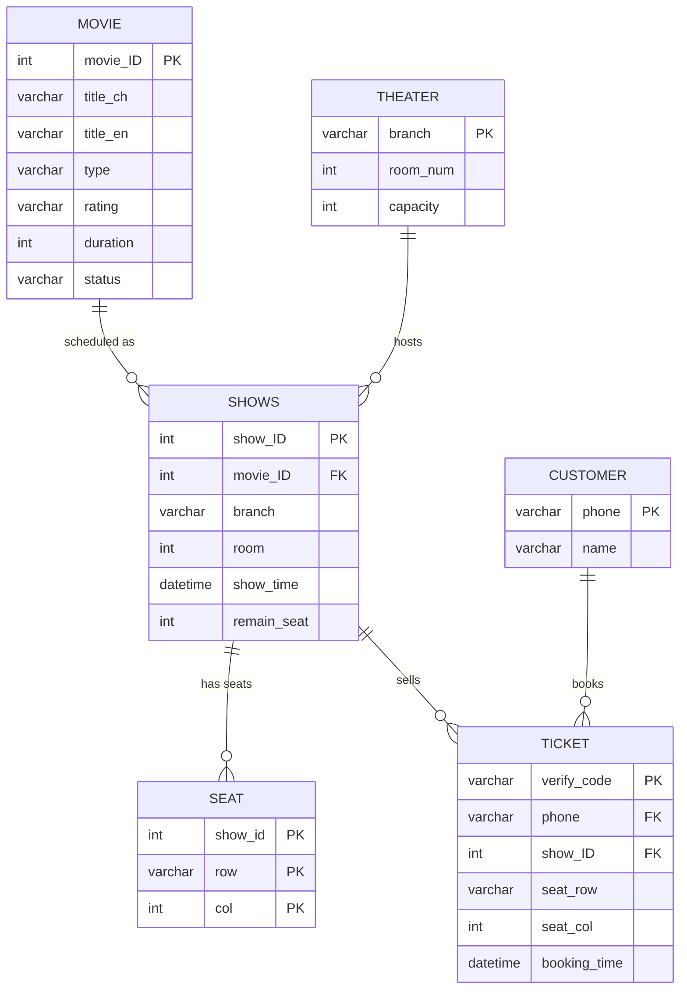

# Cinema Ticket Booking & Seat Selection System

> **Database course final project** — a full booking flow on Django + MySQL: browse films, drill down to a
> showtime, pick seats from a live seat map, get a collection code, look the order up again, cancel it.

<!-- Screenshots go here:
<p align="center">
  
</p>
-->

## What it does

| Feature | Detail |
|---|---|
| Browse films | Now-showing and full catalogue, with runtime, rating, genre and synopsis |
| Cascading selection | film → branches showing it → showtimes at that branch → seats for that showtime; every level is an AJAX call, no page reload |
| Live seat map | Remaining seats rendered as a grid; sold seats are not selectable |
| Booking | Generates a 6-character collection code, writes the ticket and decrements the remaining seat count |
| Quick booking | Returning customers are recognised by phone number, skipping re-entry |
| Lookup & cancel | Find orders by phone number and cancel a reservation |

## Database design

The course emphasis is the database, so the schema was built and populated in MySQL Workbench first, then
reflected into Django with `python manage.py inspectdb`. The models are therefore `managed = False` — the
schema is owned by the database, not by Django migrations.



`seat` uses the composite key `(show_id, row, col)`, so the same seat cannot be sold twice for the same
showtime. `ticket.verify_code` is the customer-facing collection code and doubles as the primary key.

## What is my own work

Team project for the database course. My contributions were concentrated in the booking flow — from the
template layer through to the database writes:

| Part | Mine? |
|---|---|
| **Template layer** — `base.html`, splitting js/css out of the page, replacing duplicated markup with loops | ✅ original |
| **Seat selection flow** — including the fix for seats being unselectable when branch/showtime was left unchanged | ✅ original |
| **Booking write path** — submit → insert ticket → confirmation page | ✅ original |
| **Order lookup & cancellation** — query by phone, cancel button | ✅ original |
| Schema design and data import | 🤝 team |
| Remaining views and styling | 🤝 team |

The development log in [`docs/build-notes.md`](docs/build-notes.md) records this work as it happened.

## API

All endpoints return JSON and are called with `fetch` from the templates:

| Route | Purpose |
|---|---|
| `GET /api/branches/<movie_id>/` | branches currently showing this film |
| `GET /api/showtimes/<movie_id>/<branch>/` | showtimes at that branch |
| `GET /api/seats/<show_id>/` | seat availability for that showtime |
| `POST /api/submit_ticket/` | submit a booking, returns the collection code |
| `POST /api/check_phone/` | look up a returning customer by phone |

Pages: `/`, `/movies/`, `/search_order/`, `/quick_order/`, `/cancel_order/`.

## Stack

Django 5.1 · MySQL 8 (`mysqlclient` / `PyMySQL`) · vanilla JavaScript (`fetch`) · Bootstrap templates

## Repository layout

```
.
├── DB_project/
│   ├── DB_project/         ⭐ active settings package (settings, urls, wsgi)
│   ├── myapp/              ⭐ models.py (6 tables), views.py (pages + JSON endpoints)
│   ├── templates/          index, movie list, order lookup, base layout
│   ├── static/             css / js / images / fontawesome
│   └── .env.example        config template — the real .env is gitignored
├── requirements.txt
└── docs/build-notes.md     step-by-step development log kept from the original README
```

## Running it

```bash
python -m venv DB_venv
.\DB_venv\Scripts\activate
pip install -r requirements.txt
```

Create the `movie_db` schema in MySQL and import the data, then configure the connection:

```bash
cd DB_project
copy .env.example .env      # set DJANGO_SECRET_KEY and DB_PASSWORD
python manage.py runserver
```

`.env` is gitignored, so no credentials or secret key are committed.

## Limitations

- **Booking is not transactional.** Seat write and `remain_seat` update are separate statements, so
  concurrent bookings could oversell a seat. It should run inside a transaction with the row locked.
- `myapp/views.py` defines `get_showtimes_by_movie_and_branch` twice; the second definition shadows the
  first — leftover from development.
- A duplicate copy of the settings package sits at `DB_project/` alongside the active one in
  `DB_project/DB_project/`.
