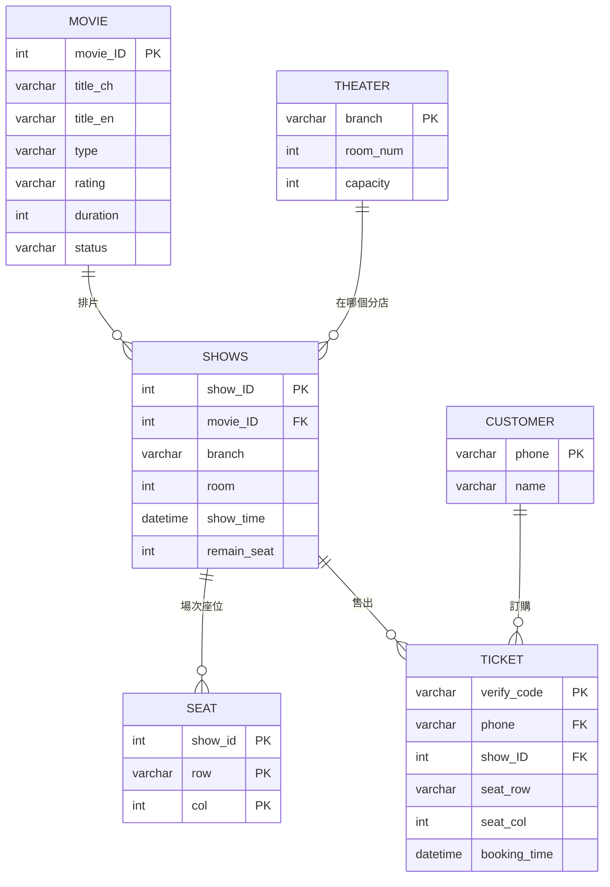

# 線上電影訂票選位系統

資料庫課程期末專題。以 Django + MySQL 實作的電影院訂票網站，涵蓋選片、選場次、視覺化選位、訂單查詢與退票的完整流程。

## 功能

| 功能 | 說明 |
|---|---|
| 瀏覽電影 | 上映中／全部電影列表，含片長、分級、類型與簡介 |
| 連動式選擇 | 選電影 → 帶出有該片的分店 → 帶出該分店場次 → 帶出該場次座位，每一層都以 AJAX 向後端查詢，不重整頁面 |
| 視覺化選位 | 以座位表呈現該場次剩餘座位，已售出的座位不可選取 |
| 訂票 | 送出後產生 6 碼取票驗證碼，同時寫入訂票記錄並更新剩餘座位數 |
| 快速訂票 | 以電話號碼辨識回訪客戶，省去重複填寫 |
| 查詢與退票 | 以電話號碼查詢訂單，可取消訂位 |

## 資料庫設計

課程重點在資料庫，所以先在 MySQL Workbench 建好綱要並匯入資料，再用 `python manage.py inspectdb` 反向產生 Django 模型（因此模型皆為 `managed = False`，schema 由資料庫端管理）。



`seat` 使用 `(show_id, row, col)` 複合主鍵，確保同一場次的同一個座位不會重複售出。

## API

前端以 fetch 呼叫，皆回傳 JSON：

| 路由 | 用途 |
|---|---|
| `GET /api/branches/<movie_id>/` | 該電影有排片的分店 |
| `GET /api/showtimes/<movie_id>/<branch>/` | 該分店的場次 |
| `GET /api/seats/<show_id>/` | 該場次座位狀態 |
| `POST /api/submit_ticket/` | 送出訂票，回傳取票驗證碼 |
| `POST /api/check_phone/` | 以電話查詢是否為既有客戶 |

頁面路由：`/`（首頁）、`/movies/`（電影列表）、`/search_order/`（訂單查詢）、`/quick_order/`、`/cancel_order/`。

## 技術棧

Django 5.1 · MySQL 8（`mysqlclient` / `PyMySQL`）· 原生 JavaScript（fetch）· Bootstrap 版型

## 安裝與執行

```bash
python -m venv DB_venv
.\DB_venv\Scripts\activate
pip install -r requirements.txt
```

MySQL 端先建好 `movie_db` 並匯入資料，接著設定連線參數：

```bash
cd DB_project
copy .env.example .env      # 編輯 .env 填入 DJANGO_SECRET_KEY 與 DB_PASSWORD
python manage.py runserver
```

`.env` 已列入 `.gitignore`，密碼與密鑰不會進版控。

> 開發過程的逐步筆記（建專案、接 MySQL、建 template 等）保留在 [`docs/build-notes.md`](docs/build-notes.md)。

## 已知限制

- `myapp/views.py` 中 `get_showtimes_by_movie_and_branch` 定義了兩次，後者會覆蓋前者，屬於開發過程遺留的重複程式碼。
- 訂票流程未使用資料庫交易，高並發下有同一座位被重複售出的可能，正式環境應以 transaction 加鎖處理。
- `DB_project/` 底下有一份重複的設定檔（`settings.py`、`urls.py`、`wsgi.py` 等），實際生效的是 `DB_project/DB_project/` 內那份。
